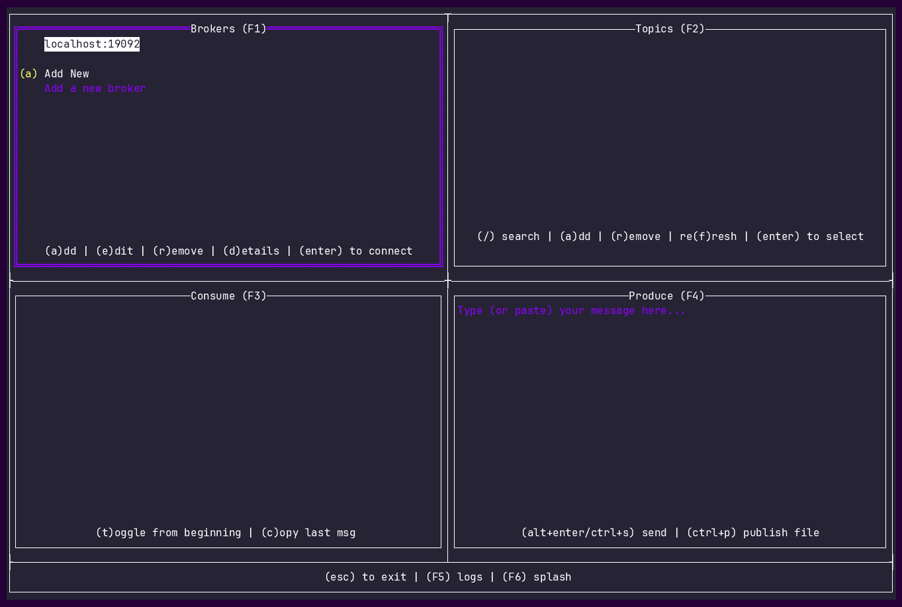

# lazykafka

```
░▒▓█▓▒░       ░▒▓██████▓▒░░▒▓████████▓▒░▒▓█▓▒░░▒▓█▓▒░              
░▒▓█▓▒░      ░▒▓█▓▒░░▒▓█▓▒░      ░▒▓█▓▒░▒▓█▓▒░░▒▓█▓▒░              
░▒▓█▓▒░      ░▒▓█▓▒░░▒▓█▓▒░    ░▒▓██▓▒░░▒▓█▓▒░░▒▓█▓▒░              
░▒▓█▓▒░      ░▒▓████████▓▒░  ░▒▓██▓▒░   ░▒▓██████▓▒░               
░▒▓█▓▒░      ░▒▓█▓▒░░▒▓█▓▒░░▒▓██▓▒░       ░▒▓█▓▒░                  
░▒▓█▓▒░      ░▒▓█▓▒░░▒▓█▓▒░▒▓█▓▒░         ░▒▓█▓▒░                  
░▒▓████████▓▒░▒▓█▓▒░░▒▓█▓▒░▒▓████████▓▒░  ░▒▓█▓▒░                  
                                                                   
                                                                   
░▒▓█▓▒░░▒▓█▓▒░░▒▓██████▓▒░░▒▓████████▓▒░▒▓█▓▒░░▒▓█▓▒░░▒▓██████▓▒░  
░▒▓█▓▒░░▒▓█▓▒░▒▓█▓▒░░▒▓█▓▒░▒▓█▓▒░      ░▒▓█▓▒░░▒▓█▓▒░▒▓█▓▒░░▒▓█▓▒░ 
░▒▓█▓▒░░▒▓█▓▒░▒▓█▓▒░░▒▓█▓▒░▒▓█▓▒░      ░▒▓█▓▒░░▒▓█▓▒░▒▓█▓▒░░▒▓█▓▒░ 
░▒▓███████▓▒░░▒▓████████▓▒░▒▓██████▓▒░ ░▒▓███████▓▒░░▒▓████████▓▒░ 
░▒▓█▓▒░░▒▓█▓▒░▒▓█▓▒░░▒▓█▓▒░▒▓█▓▒░      ░▒▓█▓▒░░▒▓█▓▒░▒▓█▓▒░░▒▓█▓▒░ 
░▒▓█▓▒░░▒▓█▓▒░▒▓█▓▒░░▒▓█▓▒░▒▓█▓▒░      ░▒▓█▓▒░░▒▓█▓▒░▒▓█▓▒░░▒▓█▓▒░ 
░▒▓█▓▒░░▒▓█▓▒░▒▓█▓▒░░▒▓█▓▒░▒▓█▓▒░      ░▒▓█▓▒░░▒▓█▓▒░▒▓█▓▒░░▒▓█▓▒░
```

<p align="center">
  <b>Kafka in your terminal. Relaxed.</b><br>
  <a href="#installation">Install</a> ·
  <a href="#features-demo">Features</a> ·
  <a href="#running-in-a-container">Docker &amp; Kubernetes</a> ·
  <a href="https://github.com/dubel/lazykafka/releases/latest">Latest release</a>
</p>

https://github.com/user-attachments/assets/af5d5fb8-2886-4d1d-9788-26accc6f1284

**Lazykafka** is a lightweight Terminal User Interface (TUI) designed to simplify the management and monitoring of Apache Kafka clusters. It provides an intuitive, keyboard-driven dashboard for visualizing broker status, inspecting topics, and tracking partition metadata without leaving the command line. The tool streamlines development workflows by allowing users to easily create or delete topics, produce test messages, and consume live data streams in real-time. Built for efficiency, Lazykafka offers a "relaxed" yet powerful alternative to complex CLI commands for developers and SREs.

**tl;dr**

 - connect to broker (connection params persisted)
     - inspect broker state: topic offsets, consumer groups (removal possible) and cluster config
 - list, add and remove topics
 - read from topics (with an option to start from beginning)
 - publish to topics (including publishing content from file with convenient file browser embedded into lazykafka)

**disclaimer**

Lazykafka is designed for quick observability, not heavy lifting. We intentionally skip consumer groups and offset tracking, so you can peek into your streams without joining a group or "stealing" messages from your actual consumers. It's a transparent window into your cluster that leaves no footprints.

# Features Demo

Here is a showcase of the main features in LazyKafka.

## Connecting and Managing Brokers
Easily connect to your cluster from the start. You can also add new brokers seamlessly – and all your configurations are automatically persisted across your sessions!



## Navigating and Managing Topics
Easily scroll through topics, use `/` to filter them dynamically, and add (`a`) or remove (`r`) topics using the modal. Removing a topic always asks for confirmation first, so a stray keypress can't wipe your data.


## Live Consumption & Clipboard Integration
Select a topic and watch messages stream in live. Press `t` to replay the topic from the beginning or switch back to new messages only. Hit `c` to instantly copy the last consumed message directly to your system clipboard for easy sharing or analysis!

The consume view keeps the **last 2,000 messages** on screen, so replaying a large topic from the beginning stays fast and memory-friendly. Messages are shown exactly as stored, including any `[brackets]` in the payload.


## Producing Messages
Quickly produce JSON messages directly to your selected topic. You can type data inline in the editor, or use the built-in file picker (`Ctrl+P`) to load larger payloads from disk!


## Broker & Cluster Details
Inspect broker configurations, verify consumer groups (and quickly delete idle ones with `r`), and view offsets by opening the cluster state panel (`d`). Note how you can effortlessly carousel through the sub-panes.


## Internal Logs
Press `F5` anytime to see application logs and check connection status and internal events. Message contents are never written to the log, only topic names and sizes, so logs are safe to attach to bug reports.

If the broker stops responding, lazykafka waits for three failed health checks (about 15 seconds) before reporting the connection as lost, so short network hiccups won't end your session.

## Where lazykafka keeps its files
Everything lives in `~/.lazykafka/`:

- `brokers.json`: your saved brokers
- `settings.json`: app settings (splash screen, last file picker directory)
- `lazykafka-DD-MM-YYYY.log`: today's log; older days are moved to `old/`

Config files are written atomically and readable only by you (`0600`). If a config file ever gets corrupted, lazykafka moves it aside as `brokers.json.corrupt-<timestamp>` instead of overwriting it, so you can recover your brokers by hand.

Logs record topic names and message sizes, never message contents.


# Requirements

- Kafka broker(s) reachable over PLAINTEXT listeners (TLS/SASL is not supported yet)
- Terminal with 80x24 minimum size

# Installation
**Homebrew (macOS/Linux**)

    brew tap dubel/tap
    brew install lazykafka

**Linux (Debian/Ubuntu)**
Go to the releases page of this repo (https://github.com/dubel/lazykafka/releases), download the .deb file, and run:

    sudo dpkg -i lazykafka_*.deb

**Linux (RHEL/CentOS/Fedora)**
Go to the releases page, download the .rpm file, and run:

    sudo rpm -ivh lazykafka_*.rpm

**Linux (Arch Linux)**
Go to the releases page, download the .pkg.tar.zst file, and run:

    sudo pacman -U lazykafka_*.pkg.tar.zst

**Go (any platform)**

    go install github.com/dubel/lazykafka@latest

**From source**

    git clone https://github.com/dubel/lazykafka && cd lazykafka
    make build

### Running in a Container

If you want to run Lazykafka directly within your Docker or Kubernetes cluster to easily resolve internal service names and connect to your Kafka brokers without exposing them externally, you can use the following one-line commands. 

Since these commands run interactively (`-it`), **they will immediately open the Lazykafka TUI** in your terminal. Once you quit the application, the ephemeral container/pod will be automatically removed (`--rm`).

**Docker / Docker Swarm**
```bash
docker run -it --rm --network=<your_network_name> ghcr.io/dubel/lazykafka
```
*(Tip: You can find your network name by running `docker network ls`. Use the network that your Kafka brokers are attached to.)*

**Kubernetes**
```bash
kubectl run lazykafka -it --rm --image=ghcr.io/dubel/lazykafka --restart=Never
```
*(Tip: In Kubernetes, you don't need to specify a network. The pod automatically uses the cluster's internal DNS. If your Kafka cluster is in a specific namespace, just append `-n <namespace>` to the command.)*

**(Optional) Logging into a Shell**

If you prefer to start a shell inside the container (e.g., for debugging) and trigger `lazykafka` manually, you can override the default command/entrypoint:

**Docker:**
```bash
docker run -it --rm --entrypoint sh --network=<your_network_name> ghcr.io/dubel/lazykafka
```

**Kubernetes:**
```bash
kubectl run lazykafka-shell -it --rm --image=ghcr.io/dubel/lazykafka --restart=Never --command -- sh
```

### Running a Persistent Container (Background)

If you'd prefer to keep a persistent jumpbox container always running in your cluster so you can quickly log into it whenever needed, you can deploy a container that runs in the background and `exec` into it to trigger the TUI.

#### Kubernetes

1. **Deploy the persistent pod:**
   ```bash
   kubectl run lazykafka-persistent --image=ghcr.io/dubel/lazykafka --restart=Always --command -- sleep infinity
   ```

2. **Access the TUI anytime:**
   ```bash
   kubectl exec -it lazykafka-persistent -- lazykafka
   ```

#### Docker / Docker Swarm

1. **Deploy the persistent container** (attached to your network):
   ```bash
   docker run -d --name lazykafka-persistent --network=<your_network_name> --entrypoint sleep ghcr.io/dubel/lazykafka infinity
   ```
   *(Note: For Docker Swarm, running this standard container on a node with access to your overlay network is usually the simplest way to maintain a persistent entrypoint).*

2. **Access the TUI anytime:**
   ```bash
   docker exec -it lazykafka-persistent lazykafka
   ```

## Quick Start

1. Start Kafka (optional - if you need a local broker for testing):
   ```bash
   make kafka-up        # empty broker on localhost:19092
   make demo-up         # or: broker pre-loaded with demo topics, groups and a live producer
   ```

2. Run the application:
   ```bash
   ./lazykafka
   ```

3. Add a broker:
   - Press `a` in the Brokers panel
   - Enter broker address (e.g., `localhost:19092`)
   - Optionally add an alias

4. Connect to broker:
   - Press `Enter` on the broker to connect (focus moves to Topics)

5. Create a topic:
   - In the Topics panel (`F2`) press `a`, enter the topic name and confirm
   - New topics are created with 1 partition and replication factor 1

6. Consume messages:
   - Press `Enter` on a topic: consumption starts and the topic becomes the produce target
   - Press `t` in the Consume panel to toggle between new messages only and from beginning

7. Produce a message:
   - Navigate to Produce panel (`F4`)
   - Type your message and press `Alt+Enter` or `Ctrl+S`, or press `Ctrl+P` to publish a file

# Keyboard Shortcuts

## Global

| Key | Action |
|-----|--------|
| `Tab` | Cycle through panels |
| `F1` / `F2` / `F3` / `F4` | Focus Brokers / Topics / Consume / Produce |
| `F5` | Toggle application log viewer |
| `F6` | Show splash screen |
| `Esc` | Close search / clear filter; otherwise exit application |

## Brokers panel

| Key | Action |
|-----|--------|
| `Enter` | Connect to broker |
| `a` | Add broker |
| `e` | Edit broker |
| `r` / `Delete` | Remove broker from the list |
| `d` | Open Cluster State |

## Topics panel

| Key | Action |
|-----|--------|
| `Enter` | Start consuming and set as produce target |
| `/` | Filter topics (`Enter` applies, `Esc` clears) |
| `a` | Create topic |
| `r` | Delete topic (asks for confirmation) |
| `f` | Refresh topic list |

## Consume panel

| Key | Action |
|-----|--------|
| `t` | Toggle from beginning / new messages only |
| `c` | Copy last consumed message to clipboard |

The view keeps the last 2,000 messages.

## Produce panel

| Key | Action |
|-----|--------|
| `Alt+Enter` / `Ctrl+S` | Send message |
| `Ctrl+P` | Publish a file (file picker: `Enter`/`Space` open, `Backspace` parent dir, `Esc` cancel) |

## Cluster State (`d`)

| Key | Action |
|-----|--------|
| `Tab` / `Shift+Tab` | Cycle pages: topic offsets, consumer groups, config |
| `↑` / `↓` | Scroll |
| `r` | Refresh; on the consumer groups page: remove selected group (asks for confirmation) |
| `f` | Refresh |
| `Esc` | Close (also cancels loading) |

# Connection behaviour

- A health check refreshes metadata every 5 seconds; the connection is reported as lost after
  3 consecutive failures (about 15 seconds).
- Advertised broker hostnames that cannot be resolved (e.g. `kafka-0` from a Kubernetes StatefulSet)
  are transparently redirected to the bootstrap host. See `docs/kubernetes-broker-resolution.md`.

# Development

## Run Tests

```bash
make test              # Unit tests only
make test-integration  # Tests requiring Kafka (starts Docker Kafka)
make test-all          # All tests
```

Integration tests are tag-gated (`//go:build integration`) and use `localhost:19092`
unless `KAFKA_BROKER` is set. Run them with `-race` when touching consume or connection code.

## Run with Local Kafka

```bash
make kafka-up      # Start Kafka in Docker
make kafka-down    # Stop Kafka
make demo-up       # Demo Kafka with seed data (for screenshots / recordings)
make demo-down     # Stop demo Kafka
```

## Release notes

Release notes for each version live in `docs/release-notes/<version>.md`.

# License

MIT, see [LICENSE](LICENSE).
